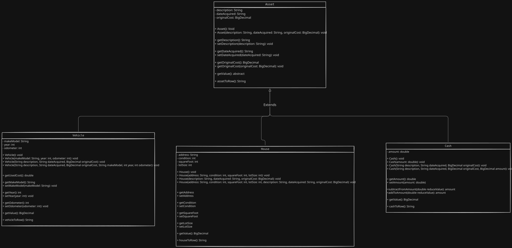

# README

---
## Diagram:

---
 ## Interesting Code

Location: App class | Main method | at lines: 39 - 67

---

## Cash subclass:
1. What issues did you run into when you try to create this class?
   - cash wanted a override method for the getValue method in its parent class

2. What were your options to address these issues?
   - build the override method
--- 
##

--- 